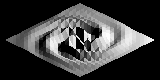
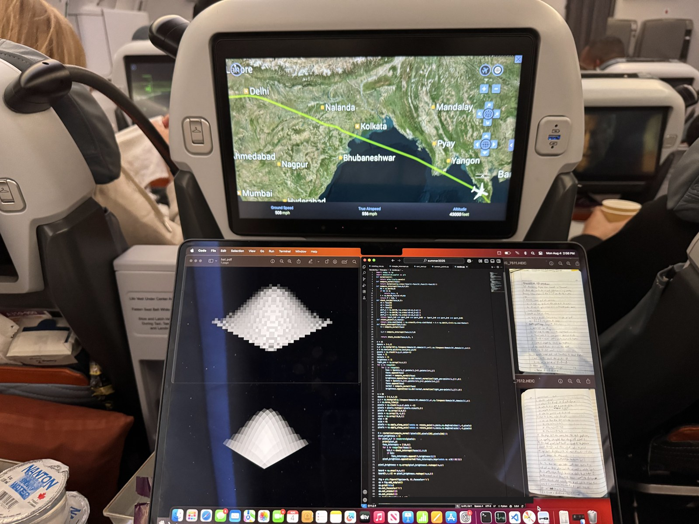
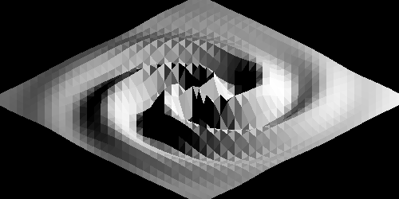

# 3D Raytracer (from scratch)

I wrote the original rendering experiments by hand to understand the geometry behind turning a 3D surface into an image. The vector operations, triangle intersections, camera rotations, and lighting calculations are implemented directly so that the mathematics remains visible.

This repository keeps those experiments alongside a small, corrected C++17 demonstration. It traces one ray per pixel through a triangle mesh and shades the nearest triangle with a single light. It is an exploration of rendering geometry, with rough edges preserved in the historical examples.



*New reproduction from the maintained demonstration: 160×80 pixels, 20×20 mesh cells (800 triangles), one worker. The exact command appears below.*

## Run it

You need a C++17 compiler, `make`, and standard C++ threading support. There are no additional library dependencies for the demonstration. Python 3 is needed only for the integration tests in `make test`.

```sh
git clone https://github.com/d-kwong/3D-Raytracer-from-scratch.git
cd 3D-Raytracer-from-scratch
make
./build/raytracer --width 160 --height 80 --grid 20 --threads 1 --output render.pgm
make test
```

Open `render.pgm` in an image viewer that supports PGM. The file is a binary grayscale image, not the floating-point text format used by some original scripts. The README preview is a PNG conversion of this output.

```sh
# Use automatic worker selection and also print the image in the terminal.
./build/raytracer --ascii

# A denser mesh and larger image; this performs substantially more work.
./build/raytracer --width 320 --height 160 --grid 30 --output larger.pgm
```

| Option | Default | Meaning |
| --- | --- | --- |
| `--width` | `160` | Image width in pixels |
| `--height` | `80` | Image height in pixels |
| `--grid` | `20` | Mesh cells along each surface axis; two triangles per cell |
| `--threads` | `0` | Worker count; `0` selects automatically |
| `--output` | `render.pgm` | Destination PGM file |
| `--ascii` | Off | Also display grayscale characters in the terminal |

Run `./build/raytracer --help` for the allowed ranges. Large resolutions and meshes remain expensive even within these ranges.

The camera spans 4.5×2.25 world units, starts at distance 3, and rotates by 30° elevation and 45° azimuth. The light is at `(2, 2, 2)`. These are fixed scene settings in the code. The camera's world-space aspect ratio stays fixed when image dimensions change, so a different pixel aspect ratio stretches the image.

## The geometry

The surface is sampled on a grid and each cell becomes two triangles. For a triangle with vertices $A,B,C$, its unit normal is

$$
\hat{n}=\frac{(B-A)\times(C-A)}{\lVert(B-A)\times(C-A)\rVert}.
$$

Each pixel supplies an origin $P$ on a camera plane. All rays share direction $D$, making this an **orthographic camera**. Substituting the ray $I=P+tD$ into the triangle's plane equation gives

$$
t=\frac{\hat{n}\cdot(A-P)}{\hat{n}\cdot D}.
$$

A valid hit needs a nonparallel ray, $t\geq0$, and an intersection inside the triangle. The inside test uses the sign of the cross product along each edge, projected onto the normal. The nearest valid $t$ determines which surface is visible.

Brightness is computed once per triangle, at its centroid $G=(A+B+C)/3$:

$$
b=\max\left(0,\hat{n}\cdot\frac{L-G}{\lVert L-G\rVert}\right).
$$

This gives flat diffuse shading: brightness depends on how the face points toward the light. There are no shadows, reflections, recursive light transport, distance attenuation, or smooth interpolated normals.

The camera plane is rotated using Rodrigues' rotation formula. The [mathematical notes](docs/mathematics.md) derive the intersection, edge tests, rotation, and numerical safeguards in more detail.



*Working on the earliest Python files on a plane. My notebook covered 3D rotation matrices, the point-in-triangle check, and line–plane intersection—the geometry behind these experiments.*

## Where the mathematics lives

| Idea | Maintained implementation |
| --- | --- |
| Dot products, cross products, normalization | `src/raytracer.hpp`: vector helpers |
| Triangle normals, mesh construction, face brightness | `make_scene` and its geometry helpers |
| Ray–plane intersection | `plane_intercept` |
| Triangle boundaries | `check_inside` |
| Rodrigues rotation and camera plane | `rotate_point`, `create_pixels` |
| Nearest visible face and pixel work | `write_pixel_data`, `render` |
| Options and PGM output | `src/main.cpp` |

The maintained implementation derives from [`experiments/multithread/render.cpp`](experiments/multithread/render.cpp). It keeps the direct plane-intersection and edge-test approach rather than replacing it with a graphics library. Pixel work is independent and distributed across workers. Every pixel still checks every triangle, so the cost grows with **pixels × triangles**; increasing both image dimensions and both mesh dimensions multiplies the work quickly.

## Experiments and results



*Preserved original output. Its exact mesh, camera, and image-generation settings have not been verified; it is not a reference image for the maintained demonstration.*

The preserved files show several directions of exploration: Python triangle tests and plotting, camera and focal-point examples, C++ surface rendering, multithreading, rotating surfaces, terminal animation, and SDL display. They establish what was implemented, but do not establish a reliable chronology or controlled performance comparison.

The swirl function and its original approximate constants remain in the maintained scene. The historical variants also contain different surfaces and partial-sphere parameterizations. Names such as `render_sphere.cpp` should not be read as proof that they render a complete sphere. See the [experiment guide](docs/experiments.md) for dependencies and known issues.

The maintained version corrects nearest-hit selection, shared-edge rejection, numerical degeneracies, thread coverage, and output handling. Its images can therefore differ from the originals. Historical source is retained separately so that these changes do not erase the original reasoning. Original processing-time estimates are not presented as measured benchmarks.

The calculations connect vector geometry directly to visibility and shading. Details such as boundary inclusion and updating the nearest distance affect the resulting image as much as the surface equation does.

## Verification and next steps

The regression suite exercises intersections, visibility order, boundary hits, rotation, finite shading, and complete rendering across worker counts. The [verification record](docs/verification.md) distinguishes executed checks from historical examples that were only syntax-checked.

Useful extensions would be perspective projection, a spatial acceleration structure, smoother normals, and a clearer interface for selecting scenes. These are future work. The current demonstration deliberately keeps the geometry small enough to follow directly.

No license has been selected for this repository.
