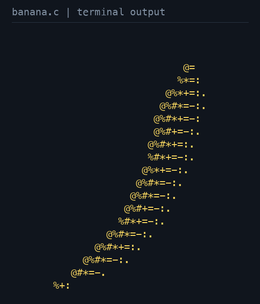

# The rotating ASCII banana

I took inspiration from Andy Sloane’s famous [`donut.c`](https://www.a1k0n.net/2011/07/20/donut-math.html) and wrote my own rotating banana in C, arranging its source into a banana shape. Sloane’s article explains the mathematics behind his rotating ASCII donut; it is credited here as the inspiration for this experiment.



This GIF was generated during the publication update by compiling and running the
unchanged [`experiments/banana.c`](../experiments/banana.c). It is a separate
parametric ASCII exercise, rather than a scene rendered by the triangle raytracer.
Its compact, banana-shaped source is preserved as written.

The program prints a 40-column by 20-row block for each angle, then sleeps for
99,999 microseconds. Its outer angle loop visits 63 values from zero in steps of
approximately 0.1 radians, covering one revolution, and repeats indefinitely.
It prints consecutive blocks without terminal clearing or cursor movement. The
GIF presents those actual printed blocks in a fixed viewport so the rotation is
easy to see; the dark background and yellow text are presentation choices.
No geometry or shading was reimplemented to produce the animation.

## Reproduce

Requirements: a C compiler, a POSIX terminal interface (macOS or Linux), Python 3,
Pillow, and a monospace font. These are optional visualization dependencies, not
requirements of the C++ renderer.

```sh
python3 -m pip install Pillow
python3 scripts/capture_banana.py
```

The script compiles the original with `cc -O2 -std=gnu11` and `-lm`, captures
exactly 63 frames through a pseudo-terminal, terminates the otherwise infinite
process, and saves `docs/images/banana-terminal.gif`. Capture has a 15-second
timeout. The GIF loops at 100 milliseconds per frame (6.3 seconds per cycle),
matching the intended sleep cadence rather than claiming measured terminal
display timing. Raw printed rows are retained in ignored `build/banana-frames.txt`.

Use `--font /path/to/monospace.ttf` to choose a font, `--output path.gif` to choose
another output, or `--timeout 30` on a slower machine. The published animation uses
20-pixel Menlo on a 528 by 616 pixel canvas. Its character content is captured
from the program; exact glyph appearance depends on the selected font.

To watch the original scrolling output directly:

```sh
mkdir -p build
cc -O2 -std=gnu11 experiments/banana.c -lm -o build/banana
./build/banana
# Press Ctrl-C to stop.
```
