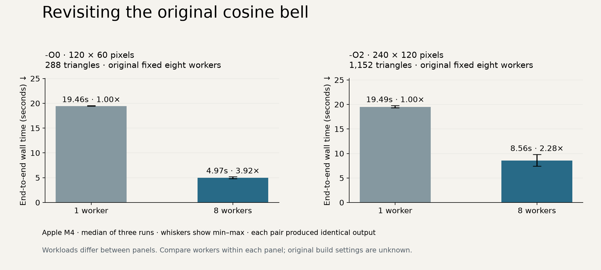
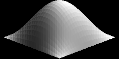

# Revisiting the original bell-surface timing

The remembered 6–7× improvement came from a 3D bell visualization with substantial pixel and triangle counts. That recollection motivated this separate investigation of `experiments/multithread/og_hat.cpp`, rather than assuming the swirl demo has the same performance.

The archived surface is a **cosine bell**, `cos(x*3.141/2) * cos(y*3.141/2)`, on `[-1,1]²`, rather than a Gaussian. The original camera, light, triangle construction, per-pixel intersection loops and fixed eight-worker partition are retained. Only temporary copies are edited: the single/multithread switch, pixel width and mesh subdivision count. Terminal display already defaults to false. Both tested pixel counts divide evenly among eight workers, avoiding the archive's remainder-handling defect for these particular runs.

## Why test two build modes?

The original build command used for the remembered timing is unknown. An unoptimized `-O0` build and optimized `-O2` build are therefore separate hypotheses, not reconstructions of a confirmed original compiler configuration. The original code copies nested vectors frequently; optimization can change both its absolute runtime and the relative cost of parallel execution.

All runs use Apple clang 21.0.0 with `-std=c++17 -pthread` on the same Apple M4 (4 performance cores and 6 efficiency cores), arm64, macOS 27.0.1. Eight workers are the original program's hard-coded value; automatic ten-worker selection from the maintained renderer is not substituted here.

## Calibration and workload selection

A single calibration pair per optimization mode used 96×48 pixels and grid 12 (288 triangles). `-O0` took 12.5484 s with one worker and 2.9281 s with eight; `-O2` took 0.7850 s and 0.7025 s. These individual trials are calibration only, with no warmup or uncertainty estimate.

Representative settings were chosen from pixel-count × triangle-count scaling to keep individual single-worker trials around 20 seconds and the repeated investigation within a few minutes. The unoptimized session uses 120×60 pixels, grid 12 (288 triangles). The optimized session uses 240×120 pixels, grid 24 (1,152 triangles), exceeding the archive's default 200×100 pixels, grid 10 (200 triangles). The settings were chosen to fit a compute budget, rather than searching settings until a target speedup appeared.

The two build modes use **different workloads**. Compare one worker against eight within each session; the sessions are not a controlled measurement of the effect of optimization alone.

## Repeated results



| Build and workload | One worker: median wall time (range) | Eight workers: median wall time (range) | Wall speedup | Original internal-timer speedup |
| --- | ---: | ---: | ---: | ---: |
| `-O0`, 120×60, grid 12 | 19.4551 s (19.4092–19.5666) | 4.9692 s (4.8355–5.1959) | 3.92× | 3.95× |
| `-O2`, 240×120, grid 24 | 19.4933 s (19.3274–19.7948) | 8.5638 s (7.4188–9.8292) | 2.28× | 2.28× |

Every output matched across the two worker settings and all eight runs within each repeated session (two warmups plus six measured trials). The calibration also produced identical outputs across both optimization settings. The larger optimized case showed substantial multithread runtime variation, visible in the chart's min–max bars.

**These attempts did not reproduce 6–7× on the current M4.** They establish measurable improvements for the original bell code under the recorded conditions. The remembered historical result remains unverified because its precise workload, compiler options, hardware and timing conditions are unavailable. No allocator changes, core-affinity changes or parameter search was used to pursue a preferred ratio.



Newly generated during this investigation from the final `-O2` session at 240×120 pixels, grid 24 (1,152 triangles), with the original camera and light. The original floating-point text output was clamped to `[0,1]`, rounded to 8-bit grayscale, and converted from PGM to PNG. This preserves the archived rendering algorithm, including its documented limitations; it is not an original saved image.

## Method and reproduction

```sh
python3 scripts/benchmark_bell.py --calibrate --output /tmp/my-bell-results.json
python3 scripts/benchmark_bell.py --width 120 --grid 12 --optimizations O0 --rounds 3 --output /tmp/my-bell-results.json
python3 scripts/benchmark_bell.py --width 240 --grid 24 --optimizations O2 --rounds 3 --preview /tmp/bell-demo.pgm --output /tmp/my-bell-results.json
```

The runner requires Python's standard library and a C++ compiler. Start with a fresh output filename for an independent run. It compiles temporary copies and removes them afterward. Repeated sessions get one warmup per worker setting, followed by three measured rounds with the order reversed each round. Every process has a 60-second timeout. Results append as separately labeled sessions to the selected output JSON. The published [raw measurement record](benchmarks/bell-scaling.json) includes every trial, compiler/hardware metadata, UTC timestamps, source hashes and output hashes.

End-to-end wall time covers process launch through exit, including scene construction and writing the original text pixel file. The original internal timer is recorded separately: it begins after scene construction and includes rendering and writing that file. The source's hard-coded estimated-time message is ignored. Pixel counts and printed image dimensions are checked, and all pixel-output hashes must match across worker counts and optimization modes within a workload. Hash equality establishes equal output, not geometric correctness: the archived nearest-hit and shared-edge defects remain.

Thermal state, power mode and other desktop activity are not controlled. These are small, sequential experiments on one machine, not a general scaling claim or a disproof of timings obtained on different hardware/builds.

The optional chart requires Matplotlib and the image conversion requires Pillow. Regenerate them from the recorded data and actual rendered PGM with:

```sh
python3 scripts/benchmark_bell.py --chart
python3 -c 'from PIL import Image; Image.open("/tmp/bell-demo.pgm").save("docs/images/bell-demo.png")'
```

Chart generation expects the two representative sessions in the recorded JSON. For independent reruns, use `--output /tmp/my-bell-results.json` to keep the publication measurement record unchanged.
