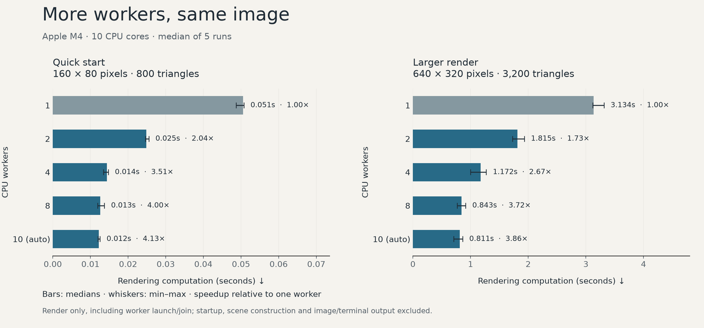

# Single worker versus multiple workers

The renderer divides pixels among CPU workers. Each pixel still tests every triangle: threading shares the work across cores, but does not change the underlying pixels × triangles cost.

## Original testing

Derek recalls that **ten threads gave roughly a 6–7× speedup in the original testing**, specifically on the bell-shaped visualization at relatively high resolution and triangle counts. He clarified the historical thread count after the publication benchmarks were completed. This is the author's account of the earlier project, preserved alongside the new measurements. Exact dimensions, mesh size, compiler flags, timing boundaries, and timing logs for that comparison have not been recovered. The new measurements below use explicitly recorded settings and do not reconstruct those original conditions. Differences between sessions cannot be attributed to a particular cause from these records alone.

The [dedicated bell investigation](bell-performance.md) rechecks `og_hat.cpp` with its original fixed eight-worker partition, using both unoptimized and optimized builds. Those eight-worker runs differ from the recalled ten-thread configuration. Their recorded settings and measurements are preserved separately from the maintained swirl measurements below.



## Measured results

These are measurements from one publication-maintenance session on an Apple M4 (4 performance cores, 6 efficiency cores), arm64, macOS 27.0.1. The compiler was Apple clang 21.0.0, using `-O2 -std=c++17 -Wall -Wextra -Wpedantic -pthread`. They describe the maintained renderer, not the historical implementation's performance.

| Workers | 160×80, grid 20: median seconds | Speedup | 640×320, grid 40: median seconds | Speedup |
| --- | ---: | ---: | ---: | ---: |
| 1 | 0.0540 | 1.00× | 3.1681 | 1.00× |
| 2 | 0.0294 | 1.84× | 1.7774 | 1.78× |
| 4 | 0.0228 | 2.37× | 1.1246 | 2.82× |
| 8 | 0.0176 | 3.08× | 0.9196 | 3.45× |
| Auto (10) | 0.0168 | 3.22× | 0.8818 | 3.59× |

Grid 20 contains 800 triangles; grid 40 contains 3,200. All generated PGM files were byte-identical across worker counts and repetitions within each workload, checked with SHA-256. The two different workloads intentionally produce different images.

More workers helped both workloads in this session. Ten workers did not provide a tenfold speedup: scene construction and output remain serial, worker creation has overhead, and this CPU has different core types. These measurements do not isolate how much each factor contributed. The small workload is particularly sensitive to startup and scheduling. The observed runtime ranges overlap for some adjacent worker settings; five repetitions do not establish a universal best worker count.

## Reproduce the comparison

```sh
make -B CXX=c++ CXXFLAGS='-O2 -std=c++17 -Wall -Wextra -Wpedantic'
python3 scripts/benchmark.py --output docs/benchmarks/thread-scaling.json
```

The benchmark runner requires only Python's standard library and the built C++ executable. It runs the same fixed swirl scene at each worker count, with ASCII output disabled. Each workload gets one warmup per worker setting, excluded from the summaries, followed by five measured rounds. Every round shuffles the worker settings with a recorded deterministic seed. Automatic selection is added when its expected worker count is not already covered by 1, 2, 4 or 8. Each process is limited to 120 seconds.

Wall time is measured using `time.perf_counter()` from immediately before subprocess launch through process exit. It includes process startup, camera and scene construction, rendering, and writing the PGM into a temporary directory. Image hashing happens afterward and is excluded. The renderer's narrower internal timer is also recorded separately; the chart and table use end-to-end wall time. Build time and warmups are excluded from summaries.

The raw [measurement record](benchmarks/thread-scaling.json) includes every warmup and measured sample, execution order, minimum/median/maximum, output hashes, compiler/build information, hardware information, and UTC timestamps. Machine load, thermal state, power mode and filesystem cache were not controlled; other desktop activity could affect the session. Do not generalize these speedups to other hardware or use them as a precise kernel-only comparison.

To regenerate just the static chart, install Matplotlib in an environment of your choice and run:

```sh
python3 scripts/benchmark.py --chart docs/benchmarks/thread-scaling.json
```

## What the original threading files establish

`experiments/multithread/threading.cpp` explores splitting an eight-million-element sum into eight tasks. Its final accumulator is never printed or otherwise consumed, so an optimizing compiler may eliminate the single-thread arithmetic. It always runs the multithread case first, and it measures integer summation rather than rendering. Its timings cannot establish a rendering speedup.

`experiments/multithread/render.cpp` contains an actual single/multithread switch, fixed scene settings and a render timer. Its historical estimated-runtime constants are not controlled benchmark results. The archived renderer also retains known nearest-hit and incomplete-workload-partitioning defects; an equal-output timing comparison does not establish geometric correctness.

For a separate archival check, temporary copies were compiled with `c++ -O2 -std=c++17 -pthread`. The only substitutions were `paint_in_terminal = false` and toggling `multithread` between `true` and `false`. Turning off terminal display also changes the original `font_adjust` to 1.0, giving **200×100 pixels, grid 20**, with 10 workers in the multithread case. The archive itself was not edited.

With one warmup per setting and five interleaved, shuffled measured rounds, original single-thread median end-to-end time was **9.5635 s** (range 9.4808–9.6587 s), versus **4.9954 s** with multiple threads (4.4747–5.5625 s): **1.91×** in this session. Every original text pixel output had the same SHA-256. This checks that the timing variants produced the same original output on this machine; it does not correct the original rendering algorithm. These runs use different dimensions and text output from the maintained renderer, so the two sets of numbers are not a controlled before/after cleanup comparison. The separate [raw archival results](benchmarks/legacy-renderer.json) record the individual runs.

```sh
python3 scripts/benchmark.py --legacy --output docs/benchmarks/legacy-renderer.json
```

The original render keeps its own historical hardware estimates in its stdout; the benchmark ignores those estimates and measures actual wall time. Temporary files are removed after measurement. The published chart shows only the maintained renderer, keeping that comparison consistent.
